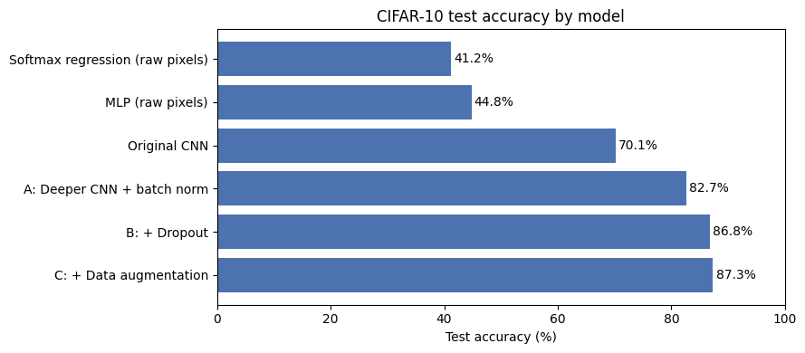
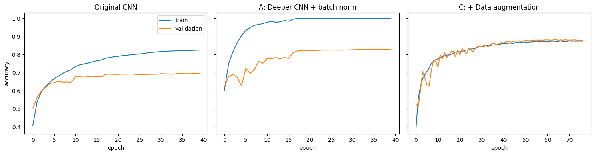
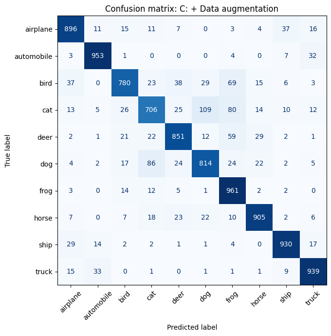
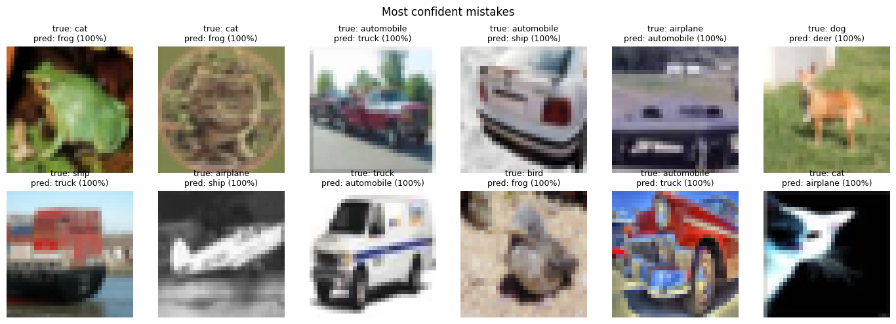

# CIFAR-10 Image Classification: From Baseline to Improved CNN

A controlled experiment on CIFAR-10 that starts from raw-pixel baselines, reproduces a simple CNN, and improves it one change at a time to measure what each change contributes. **Final test accuracy: 87.3%**, up from 70.1% for the original CNN and 44.8% for an MLP baseline.

**Stack:** Python, TensorFlow/Keras, NumPy, pandas, scikit-learn, Matplotlib · trained on a Colab T4 GPU

## Dataset

[CIFAR-10](https://www.cs.toronto.edu/~kriz/cifar.html): 60,000 32×32 RGB images across 10 balanced classes (airplane, automobile, bird, cat, deer, dog, frog, horse, ship, truck). The official 50,000-image training set was split into **45,000 train / 5,000 validation**. The 10,000 test images were used only for the final evaluation of each model.

## Experimental setup

Every model was trained under the same conditions so the comparisons are fair:

- Pixels scaled to [0, 1]
- Adam optimizer (learning rate 1e-3), sparse categorical cross-entropy, batch size 64
- Early stopping on validation accuracy (best weights restored)
- Learning rate halved when validation accuracy plateaued
- Fixed random seed

## Models

| Model | Description |
|---|---|
| Softmax regression | One dense layer from 3,072 raw pixels to 10 classes (multinomial logistic regression) |
| MLP | Two hidden layers (512, 256) with dropout, on raw pixels |
| Original CNN | Conv(100) → pool → Conv(32) → pool → Dense(64) → Dense(10), from my earlier writeup |
| A: Deeper CNN + batch norm | Three VGG-style blocks of two 3×3 convolutions (32 → 64 → 128 filters), each followed by batch normalization |
| B: + Dropout | Model A plus dropout (0.2 → 0.3 → 0.4 across blocks, 0.5 before the output) |
| C: + Data augmentation | Model B plus random horizontal flips and ±10% shifts during training |

## Results

| Model | Parameters | Train acc. | Val acc. | **Test acc.** | Train − val gap |
|---|---|---|---|---|---|
| Softmax regression | 30.7K | 45.2% | 41.5% | **41.2%** | 3.8 |
| MLP | 1.71M | 41.6% | 44.1% | **44.8%** | −2.6 |
| Original CNN | 106K | 82.4% | 69.6% | **70.1%** | 12.8 |
| A: Deeper CNN + batch norm | 552K | 100.0% | 82.9% | **82.7%** | 17.1 |
| B: + Dropout | 552K | 92.1% | 87.1% | **86.8%** | 5.0 |
| C: + Data augmentation | 552K | 87.2% | 88.2% | **87.3%** | −1.1 |

### What each change contributed

- **Convolutions (+25 points over the MLP).** The original CNN, with fewer than a tenth of the MLP's parameters, beat it by 25 points. Treating an image as a spatial grid rather than a flat vector is the single biggest gain.
- **Depth and batch normalization (+12.6 points), with heavy overfitting.** Model A reached 100% training accuracy while validation stalled near 83%.
- **Dropout (+4.1 points).** Cut the train–validation gap from 17.1 to 5.0 points, so most of the overfitting was fixed here.
- **Data augmentation (+0.5 points).** Closed the remaining gap entirely. Validation accuracy slightly exceeds training accuracy because flips and shifts make training images harder than test images.

**Caveat:** the original CNN and model B reached the 40-epoch limit. Their validation curves had largely flattened, but B may have gained slightly with more epochs, so the small augmentation gain should not be over-interpreted.

## Error analysis (final model)

| Class | Accuracy | | Class | Accuracy |
|---|---|---|---|---|
| cat | 70.6% | | horse | 90.5% |
| bird | 78.0% | | ship | 93.0% |
| dog | 81.4% | | truck | 93.9% |
| deer | 85.1% | | automobile | 95.3% |
| airplane | 89.6% | | frog | 96.1% |

- **Animals are hardest, vehicles easiest.** Cat, bird, and dog are the three weakest classes. Every vehicle class is above 89%.
- **Cats and dogs are confused in both directions:** 109 cats were predicted as dogs, and 86 dogs as cats. At 32×32 pixels, the features that separate them are often only a few pixels wide.
- **The model over-predicts "frog."** Cats (80), birds (69), and deer (59) were misclassified as frogs. A plausible explanation is that small animals on green and brown natural backgrounds look alike at this resolution.

## Reproducing

Open `cifar10_cnn.ipynb` in [Google Colab](https://colab.research.google.com), set **Runtime → Change runtime type → T4 GPU**, and choose **Runtime → Run all**. Training all six models takes about 35 minutes. The notebook is saved with its outputs, so the results can be viewed without re-running.

## Possible next steps

- Train B and C to full convergence with a longer epoch budget for a cleaner augmentation comparison
- Stronger augmentation (random crops, cutout) and a learning-rate schedule such as cosine decay
- A residual architecture (ResNet-style) or transfer learning from a pretrained model
